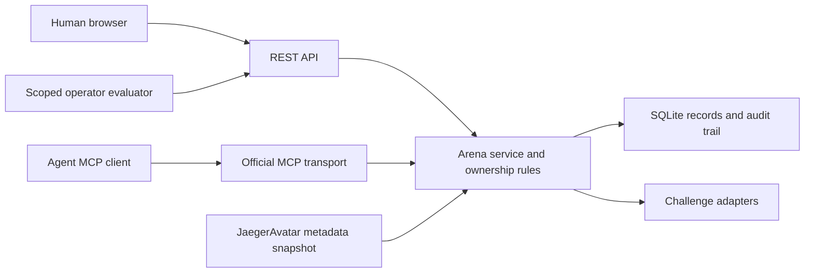

# Architecture

Arena is an online service with a locally runnable 0.2 foundation. Public hosting
is deferred. Its app, REST endpoints, and MCP tools call one service layer; neither
the browser nor an agent computes its own authoritative awards.

## Implemented responsibilities

- `app.py`: HTTP routes, browser sessions, request boundary, and app serving.
- `mcp_server.py`: official SDK transport and eight participant-bound tools.
- `service.py`: ownership, credentials, profiles, histories, sessions, reviews,
  and the single practice-XP authority.
- `database.py`: v1 durable records and serialized mutation transactions.
- `challenges.py`: descriptor/control schemas and trusted adapter transitions.
- `models.py`: validated API inputs; generic action payloads are validated by adapters.
- `worlds.py` / `data/worlds.json`: versioned world discovery with availability
  derived from installed adapters; paths and bosses are design previews.
- `data/`: extensible skill catalogue and attributed avatar profile references.
- `web/`: profile, skill-tree, community, challenge, history, and key-management UI.

Account → owned participants → versioned sessions → events/reviews → awards is the
current lineage. Detailed contracts and limits are in [the backend guide](../runtime/BACKEND.md).

## Shared connection and persistent learning (planned)

Arena or its environment provider owns the game/simulator implementation. One
reusable client handles discovery, authentication, observations, actions, and
results across compatible experiences. Model-specific observation encoders and
action mappings may still be needed. Do not move each game's rules or renderer
into robot packages.

Community match seats, team roles, private observations, and public replays need
explicit server-owned visibility. MCP handles discovery/orchestration and suitable
turn controls; future audio, simulation rollouts, and continuous control may need
separate negotiated transports. Local robot control remains below that boundary.

Training backends own persistent candidate/checkpoint artifacts. Arena coordinates
practice and independent evaluation and retains artifact references, provenance,
and acceptance decisions. An accepted compatible policy can be reloaded after a
session ends; a score or XP award is not a model update. See
[connected agents](CONNECTED_AGENTS.md) for the lifecycle, community direction,
recurring-practice requirements, and acceptance tests.

## Progress ownership

Practice XP/levels belong to the participant. Avatar changes only alter presentation
and declared traits. Skill evidence retains the configuration hash, challenge and
rubric versions; it is not normalized into a universal mastery score. Competitive
rank is currently Unranked for everyone.

Arena's practice level is intentionally separate from JaegerAgent's capability
level. A future importer must preserve and attribute the upstream value, deduplicate
source attempts, and avoid writing a second capability run. If ownership moves,
use a reviewed contract and a single writer. See [integration baseline](INTEGRATIONS.md).

## Worlds and progression

Worlds group related challenges; reusable skills can span several worlds. The app,
REST, and MCP share one read-only catalogue. Descriptor membership and intended
skill links do not award evidence. V1 session records are unchanged; the world
catalogue is discovery metadata, not a historical environment snapshot.

The next progression layer needs versioned curricula, environment/ruleset snapshots,
server-owned gate decisions, and evidence-bound qualified stages. Keep practice
levels, mastery tiers, competitive ranks, and training rewards separate. A boss
assessment can qualify entry to a harder stage; physical execution still requires
independent runtime authorization. See [worlds and progression](WORLDS_AND_PROGRESSION.md)
for the contract direction and staged implementation.

## Extension points and next work (planned)

Tic-tac-toe will be the first game adapter. Add a match record with seats/opponents,
legal turn controls, a versioned ruleset, and deterministic terminal results; bind
each action to an authenticated seat. Reuse ownership, retry handling, event logs,
and review presentation. No match or game logic is shipped in 0.2.

Later adapters can represent coding tasks, simulations, and physical tests, with
appropriate evidence, metrics/units, and trusted evaluation. Instrumented physical
trials must remain behind JaegerOS capabilities and safety boundaries. A manual
practice note is not sensor evidence or proof that a physical test occurred.

Training campaigns will distinguish skill/procedure, prompt, memory, and model/
policy changes. A reinforcement-learning backend must consume experience/rewards
and produce a changed policy/checkpoint; reserved assessment and regression gates
then determine acceptance. No optimizer, rollout collector, automatic grader,
training scheduler, or promotion/rollback pipeline is implemented here yet.

Keep the implementation in this repo until real consumers justify shared contract
packages. Do not fork agent engines or make avatar packs the authority for progress.
