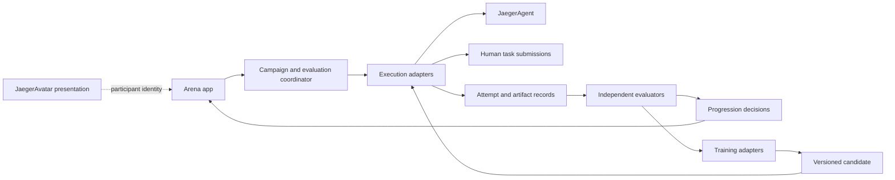

# Architecture (planned)

This is an implementation direction, not a released API or wire schema. Arena has
no runtime, database, or training connector yet. Public contracts should be fixed
with actual consumers; avoid extracting speculative shared packages.

## Components and ownership (planned)

The coordinator schedules runs and checks budgets. Runners execute through supported
interfaces; evaluators consume evidence. Training backends return a candidate
configuration or checkpoint, and independent assessment determines acceptance.
The app reads decisions from the responsible service; it does not calculate a
second version of mastery in browser code.

## Evidence model (planned)

| Record | Information to preserve |
| --- | --- |
| Participant | Stable identity and kind: human or agent; optional avatar reference. |
| Configuration | Model/checkpoint, prompts, skill revisions, tools, runtime version, and environment fingerprint. |
| Challenge | Immutable task and dataset versions, difficulty, evaluator, budget, and practice/assessment split. |
| Attempt | Unique run identity, participant/configuration/challenge references, start/end times, outcome, and artifacts. |
| Assessment | Evaluator and rubric version, scores, uncertainty where applicable, feedback, and evidence references. |
| Training run | Baseline, method/backend, input evidence, resource use, changed components, and candidate outputs. |
| Decision | Policy version, qualifying assessments, promotion/rejection/rollback, and previous accepted version. |

Use explicit units for measurements (for example, duration in seconds) and document
dimensionless score ranges. External adapters preserve the source contract and
record any normalization instead of silently changing units or meanings. Publishing
competition entries should use intentionally selected evidence, not credentials,
private prompts, or unrelated participant records.

## One authority per level (planned)

JaegerAgent already writes capability state. The first adapter should import its
results as source evidence and display its existing level, clearly attributed.
Importing a result must not invoke its scorer again or write another capability
run. Deduplicate by stable source identity plus source revision/run identity.

Arena's independent certification policy may eventually differ from an agent's
local practice level. If introduced, name and version that distinction explicitly;
do not display two incompatible values as the same level. A later migration of
policy ownership needs a reviewed contract and a single writer. See
[integration baseline](INTEGRATIONS.md).

## Training semantics (planned)

Support distinct change types: skill or procedure revisions; prompt changes;
memory changes; and actual model/policy updates through a training backend.
Each run records the before/after configuration and candidate artifacts. Model
training needs a backend with an optimizer and reward/trajectory inputs; this
repository does not provide one yet.

Practice tasks can supply feedback to training. Reserved assessment tasks must
remain independent of the learner's edits and training data. Grader versions and
grading conditions are part of the evidence. A higher training score alone is
insufficient for promotion. Regression gates and repeated assessment results should
support acceptance decisions, with a retained previous version for recovery.

## Execution boundary (planned)

Use supported process/service APIs for JaegerAgent; avoid importing private engine
internals or copying the execution loop. Begin with read-only result import before
adding job control. Benchmark execution runs task code and will need isolation,
resource limits, cancellation, and explicit tool scopes in the runner. A static
website is not a runner. Physical or simulated robot challenges continue through
JaegerOS capabilities and cannot bypass lower-level safety.

Storage technology, transport, authentication, model-training provider, and deployment
topology remain implementation decisions. Define them when the first working
loop provides real requirements, and pin dependencies then.
