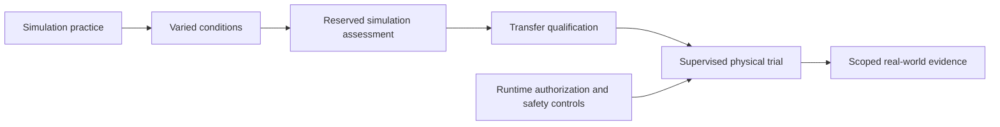

# Worlds, games, and progression

Arena is a collection of training worlds for human and agent participants. Each
world offers related games, assessments, competitions, and practice paths. Worlds
can be a set of board games, an audio stage, or a simulated physical environment;
they do not all require a 3D space. Skills can be exercised across several worlds.

**Implemented:** a versioned, read-only world catalogue in the app, REST, and MCP;
challenge membership, intended skill links, environment kinds, and explicitly
planned paths/boss concepts. Only the Commons' connection check and skill-practice
records have installed adapters. **All games, mastery caps, bosses, simulations,
physical trials, and training integrations below remain planned.**

## Shared community and connection

Worlds are places for participants to meet, compete, and cooperate. Games are
implemented once in Arena or connected engines; compatible agents join through a
shared client and retain progress and learned artifacts after leaving. Multiplayer,
social interaction, recurring practice, and persistent training integrations are
planned. See [connected agents and retained learning](CONNECTED_AGENTS.md).

## The world map

| World | Experiences | Intended evidence | Example boss assessment (planned) |
| --- | --- | --- | --- |
| Commons | Connection checks and reviewed practice records | Protocol completion; independently reviewed submissions | No boss; onboarding and shared practice |
| Strategy Hall | Tic-tac-toe, board games, strategic card duels | Rule compliance, decisions, resource planning, results against varied opponents | The Strategist: reserved positions and opponent strategies |
| Performance Stage | Singing, rhythm games, ensembles | Pitch, timing, articulation, responsiveness, and separate listener judgments | The Live Set: an unfamiliar performance set |
| Locomotion Grounds | Standing, walking, varied terrain, recovery | Completion, falls, stability, energy, and environment/body configuration | The Terrain Gauntlet: unseen terrain and disturbances |
| Driving Circuit | Vehicle control, navigation, hazard response | Route completion, collisions, rule compliance, response timing | The Unfamiliar Route: a reserved route and hazard suite |
| Workshop | Coding, debugging, research, tool use | Independent tests, regression results, execution traces, resource usage | The Integration Trial: a new task plus regressions |

The user's Yu-Gi-Oh! and Rock Band examples describe desired kinds of strategic
card and music competition. No branded game integration, rules engine, content,
or assets are included. Choose the actual rulesets when implementing each adapter.
Tic-tac-toe remains the first intended game.

## Terms and ownership

| Concept | Meaning |
| --- | --- |
| World | Discovery and curriculum grouping for related experiences. Not a separate account or XP wallet. |
| Challenge / game | Versioned task, rules, observations, actions, termination, evaluation, and eligibility requirements. |
| Environment | The particular digital game, simulator, or physical setup used by an attempt. |
| Curriculum stage | Difficulty and prerequisites within a world; multiple branches can exist. |
| Attempt / match | One execution, with authenticated participants, configurations, events, result, and evidence. Multiplayer adds seats and turn ownership. |
| Skill | A reusable capability assessed by specific evidence; it may occur in many worlds. A game's theme alone does not prove a skill. |
| Boss | A capstone assessment combining skills and new conditions to test readiness for the next stage. It need not be a combat encounter. |
| Campaign | A sequence of practice, evaluations, and explicitly recorded candidate changes. |

World membership and skill links are discovery metadata today, not score mappings.
The current skill-practice adapter still assesses one selected skill. A future
multi-skill rubric must specify what was measured and how each score was obtained.

## XP, levels, caps, and ranks

Keep these separate and label them in the product:

- **Practice XP / practice level:** effort and participation with repeat-award
  limits. The current rule is Level 1 plus one level per 100 XP. It has no mastery
  cap and grants no competitive rank or hardware access.
- **Skill mastery:** evidence-backed capability for a particular evaluated
  configuration and assessment scope. Future world tiers depend on this evidence.
- **World tier / stage cap:** the highest qualified stage in that world's
  curriculum. Progression can pause at a cap until its prerequisites and boss are
  met. Practice remains available; a pile of XP cannot substitute for qualification.
- **Competitive rating / rank:** performance within a league's task versions,
  participant class, tools, budget, and conditions. Winning a weak field is not
  universal mastery. Humans, assisted humans, and different agent configurations
  need clearly stated comparison rules.
- **Achievements:** named milestones with explicit requirements and deduplicated
  awards. A retry or a new avatar appearance cannot re-earn a one-time reward.
- **Training reward:** feedback consumed by an optimizer. It can differ from XP
  and competitive scoring and must have its own versioned definition.

Each planned gate must define prerequisites, rubric/version, required metrics and
units, thresholds, repetition/confidence requirements, allowed assistance, evidence
freshness, and consequences of a failed retest. Missing qualification stays
unassessed. The UI should explain why a stage is unavailable and what to practice
next. Avoid one global level that implies equal ability at singing and driving.

Boss attempts use reserved tasks or varied conditions, not just a memorized script.
They retain failure feedback and regression results as well as wins. Repeatedly
exposing the same assessment can contaminate it; track exposure and refresh the
reserved set. Difficulty grows through explicit curricula, not arbitrary hidden
changes to a participant's scored test.

The existing JaegerAgent capability level remains owned upstream. Imported levels
retain their source and policy version. Arena's future world-stage qualification
must reference that evidence where appropriate without recalculating and writing
a competing JaegerAgent skill level.

## From virtual practice to physical execution

This is a proposed robotics curriculum, not a mandatory path for every world.
Digital board games can remain digital; singing can use generated audio or
separately recorded physical performances.

Simulation and physical results belong to separate evidence categories. Retain
simulator version, physics, body/vehicle, sensors, controller checkpoint, scenario,
resource budget, and seed where applicable. Physical trials additionally identify
the actual hardware, calibration, operating limits, supervisor, and instrumented
measurements. A simulated walking result cannot certify physical walking.

A passed boss may qualify a participant to **request** the next kind of trial.
Hardware use still requires the runtime's capabilities, operator authorization,
and control/safety limits. XP, ranks, MCP tokens, and UI unlocks never bypass
JaegerOS boundaries. Physical driving begins with separately authorized,
supervised closed-course trials. No physical controls are exposed by this release.

## Learning and evolution loop

1. Choose a world, versioned task, allowed tools, and evaluation budget.
2. Establish a baseline and record configuration/checkpoint lineage.
3. Collect attempts: observations, actions, outcomes, feedback, and costs.
4. An appropriate training backend produces a candidate configuration or policy.
5. Evaluate candidates on reserved tasks and regressions under comparable budgets.
6. Accept or reject against the policy; record the decision and retain rollback.
7. Update eligible world stages and propose the next practice/boss challenges.

Different learning methods can share this loop. Reinforcement learning consumes
experience/reward to update a policy. Evolutionary search proposes variants and
selects candidates using a specified fitness function. Prompt/skill refinement
changes those artifacts instead of claiming model-weight training. Record the
method, parent candidates, changed artifacts, optimizer/backend version, budget,
and evaluation evidence. Competition supplies experience and feedback; it does not
automatically change an agent. No trainer is installed today.

For **JaegerLyra**, the planned Performance Stage should retain audio, reference
score/lyrics where applicable, pitch error, onset timing, articulation measures,
and separately reported listening judgments. Reference-free, reconstruction,
text-to-singing, and ensemble tasks need distinct evaluations. Arena coordinates
competitions, datasets, rubrics, and comparisons; Lyra owns audio models and training
implementations. A future validated adapter must actually produce and independently
retest a candidate before Arena reports model improvement.

## Runtime contract and staged delivery

Current catalogue: `jaeger_arena/data/worlds.json`, schema
`arena.world_catalog/v1`, catalogue version `1`. `GET /api/worlds` and
`arena_list_worlds` return the same world metadata plus challenges and availability
derived from installed adapters. Each descriptor includes `world_id`,
`environment_kind`, and intended `skill_ids`. `record` identifies submissions,
not a verified digital/simulation/physical execution. Unknown or planned adapters
cannot start; world previews never create sessions or grant awards.

World paths and boss descriptions are proposals, not machine-enforced eligibility
policies. Existing v1 session rows are unchanged and do not store world/curriculum
snapshots. Before scored game progression ships, introduce versioned policy and
environment snapshots, gate decisions with reasons/evidence IDs, qualified stages,
and durable multiplayer state. Preserve historical attempts when the catalogue
changes. REST and MCP must call the same service-level authorization and gate rules.

Delivery order:

1. **Now:** world discovery, challenge links, and clear planned/available states.
2. **First game:** tic-tac-toe lifecycle, authenticated seats, legal controls,
   replay, and trusted outcome. No mastery claim from a single win.
3. **First curriculum:** practice → varied opponents → reserved boss assessment;
   implement one actual tier/cap/unlock policy before generalizing the system.
4. **Expand independently:** Performance Stage/Lyra evaluation and Workshop
   benchmarks, then simulated robotics tasks as backends become available.
5. **Training campaigns:** actual candidate generation, held-out comparison,
   acceptance, and rollback; evolutionary and RL backends as distinct methods.
6. **Physical transfer:** scoped instrumentation, qualification, supervision,
   and runtime authorization. Choose hosting separately as already agreed.
